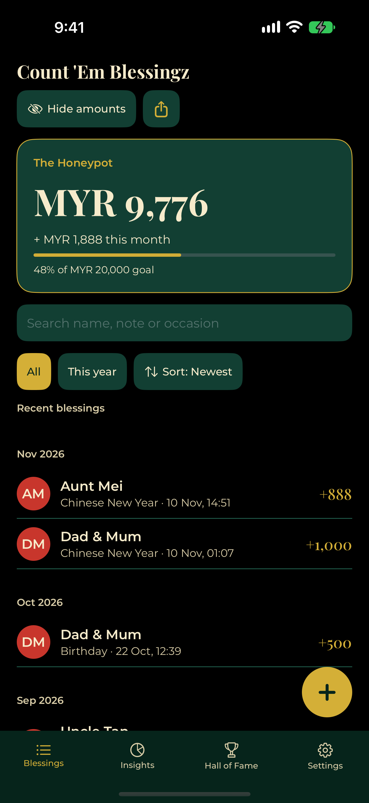
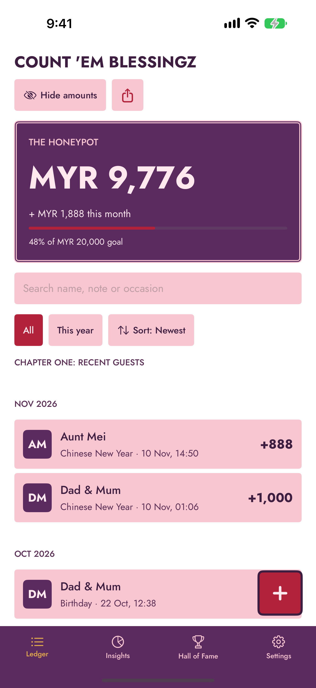
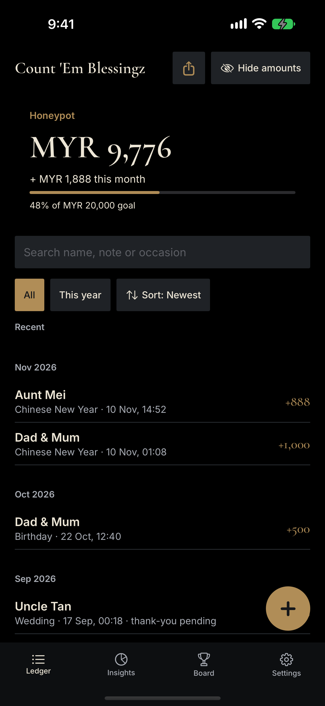

# Count 'Em Blessingz

A private, offline iPhone app for keeping track of the money people have blessed you with: angpao, birthday gifts, wedding envelopes, duit raya and more. **No account, no cloud, no tracking.** Everything stays on the phone, and family can combine their lists by sharing a small file.

| Jade & Gold | The Grand Ledger | Quiet Fortune |
|---|---|---|
|  |  |  |

## Features

- **Record** blessings in seconds (name, amount, occasion, optional photo and note); the time is filled in for you. Edit, delete with undo, search and sort.
- **Understand** them: a donut chart by person, month or occasion; a profile for every giver with a by-year chart; a Hall of Fame with milestones; a year-in-review card to share.
- **Say thanks**: a thank-you list and optional local reminders.
- **Combine lists with family**: share your entries as a `.blessingz` file (AirDrop, WhatsApp, Telegram, Mail, Messages, Files), and review a file from someone else before anything is added. Duplicates are detected, similar names are never merged without asking, and an import can be undone.
- **Private by design**: Face ID lock, a privacy cover in the app switcher, a Hide amounts switch, and a widget that respects both. No network code at all.
- **Yours**: three looks, your country's currency (with exchange-rate conversion when you change it), CSV export, and backup and restore to a file.

## Requirements

iOS 17 or later, iPhone only (portrait). Built with Xcode 27 and Swift. No third-party packages.

## Build and test

The Xcode project is **generated** from `project.yml` with [XcodeGen](https://github.com/yonaskolb/XcodeGen) (`brew install xcodegen`). Edit `project.yml`, not the `.pbxproj`, and run `xcodegen generate` after adding or removing files.

```bash
xcodegen generate

# unit tests: fast (a few seconds), about 200 tests
xcodebuild test -scheme CountEmBlessingz -destination 'platform=iOS Simulator,name=iPhone 17 Pro Max'

# UI tests and the automatic accessibility audit: a few minutes, Debug build only
xcodebuild test -scheme CountEmBlessingzUI -destination 'platform=iOS Simulator,name=iPhone 17 Pro Max'
```

Debug-only launch arguments for development (compiled out of Release): `-seedDemo` (sample data), `-demoFresh` (dates shifted to look current), `-demoTheme jade|grand|quiet`, `-demoTab 0..3`, `-demoImport` (opens a sample import review), `-uiTesting` (empty store).

## How it is built

| Layer | What lives there |
|---|---|
| `Models/` | SwiftData models (`Blessing`, `Blesser`, `AppSettings`, `CurrencyConversion`), enums, and the App Group store. Money is always `Decimal`. |
| `Services/` | Pure logic and I/O: money formatting and strict parsing, currency conversion, duplicate detection, the import plan and commit, the exchange file format, export and backup, reminders, the lock. Most of it has no UI and is unit tested. |
| `Theme/` | One set of views driven by tokens: `AppTheme` is injected through the environment and the three themes are data, not separate screens. |
| `Features/` | SwiftUI screens: Home, Insights, Hall of Fame, Profile, Settings, Add/Edit, Import review, Onboarding, Lock, Effects. |
| `App/` | The app entry, the tab container (a `TabView` with a themed bar), routing and shared UI state. |
| `CountEmBlessingzWidget/` | The home-screen widget, reading the same store read-only. |

How the merge works, the file format and the duplicate rules are in **section 18 of [BLUEPRINT.md](BLUEPRINT.md)**.

## Documents

- **[NEXT_STEPS.md](NEXT_STEPS.md)** is the checklist of what only the owner can do: GitHub, signing, real-device testing and the App Store, in order.
- **[RELEASE_1_1_PLAN.md](RELEASE_1_1_PLAN.md)** is the build brief for 1.1 (tip jar, wishes and prayers, photo fixes). **[DONATION_PLAN.md](DONATION_PLAN.md)** has the tip jar detail.
- **[BLUEPRINT.md](BLUEPRINT.md)** is the original design and plan, with the implementation status, deviations and known limitations at the top, and the as-built merge import (section 18) and quality status (section 19).
- **[release/](release/)** has the detail behind the checklist: a fill-in sheet, the submission guide, the listing text, 18 ready screenshots, a real-device test checklist, a script that sets your bundle id, and a sample import file for App Review.
- **[docs/](docs/)** holds the public privacy policy and support pages (published with GitHub Pages).
- **[design/app-icon/](design/app-icon/)** holds the SVG sources of the app icon.

## Privacy

The app collects nothing and makes no network connections. See the [privacy policy](docs/privacy-policy.md).
